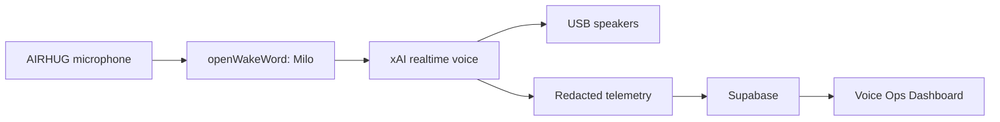

<p align="center">
  
</p>

<p align="center">
  
  
  
</p>

<p align="center"><strong>Milo</strong> is a headless Grok voice speaker for a Raspberry Pi 4: say the wake phrase, talk, and hear the reply on the USB speakers.</p>

## What it does

Milo sits in a room, listens for a wake phrase, and holds a spoken conversation with xAI's realtime voice API. Replies play through a USB speaker. A redacted copy of each turn is stored on the Pi and synced to Supabase for the Voice Ops Dashboard.

The default path is speech-to-speech over a WebSocket (`grok-voice-latest`, voice `eve`). A local cascade (faster-whisper, Grok chat, Piper) stays available when you set `conversation.engine` to `local`.

Until a custom model is trained, the wake phrase is **hey jarvis**. The product name is Milo.

## Architecture



Capture is 48 kHz from the microphone. Wake-word scoring uses 16 kHz. The realtime socket uses 24 kHz PCM. Playback is one long-lived output stream with a short jitter buffer, fed by a queue so each audio delta does not reopen the device.

## Hardware

| Piece | How it is used |
| --- | --- |
| Raspberry Pi 4, 4 GB | Runs the voice loop under systemd. PipeWire is the audio server. |
| AIRHUG USB microphone | Capture. Two inputs, native 48 kHz, no hardware echo cancellation. |
| Sanyun SW208 | Active bookshelf speakers. USB into a Pi USB-A port. |

The Pi 4 USB-C socket is power only. Do not put the speaker there. Bluetooth is not on the default playback path. If no USB speaker is present, Milo uses the 3.5 mm headphone jack.

## Quick start

On the Pi, over SSH:

```bash
ssh <user>@<pi-hostname>
git clone <repository-url> milo
cd milo
sudo bash deploy/install.sh
```

The installer copies the tree to `/opt/gva/app`, creates a virtualenv at `/opt/gva/venv`, and installs systemd units. It does not start them until `gva doctor` passes.

Edit the secrets file as root, then check the box:

```bash
sudoedit /etc/gva/gva.env
sudo gva doctor
gva audio devices
gva test-audio
sudo systemctl enable --now gva-voice.service gva-backend.service gva-sync.service gva-retention.timer gva-backup.timer
```

`gva doctor` must succeed before the voice service is enabled. A failed doctor run still installs the units, and leaves them stopped.

## Audio test

`gva test-audio` plays a short tone on the device Milo will use and prints the card name.

```bash
gva test-audio
gva test-audio --seconds 3
gva audio devices
```

An empty `audio.output_device` means: prefer a USB playback device whose name does not contain AIRHUG, otherwise the headphone jack.

## Configuration

Non-secret settings live in `/etc/gva/config.yaml`, seeded from [`config/config.example.yaml`](config/config.example.yaml).

| Key | Default | Meaning |
| --- | --- | --- |
| `conversation.engine` | `realtime` | `realtime` or `local` |
| `conversation.realtime.model` | `grok-voice-latest` | Realtime model |
| `conversation.realtime.voice` | `eve` | Spoken voice |
| `audio.input_device` | `AIRHUG` | Substring of the capture device |
| `audio.output_device` | empty | Empty selects USB, then the 3.5 mm jack |
| `audio.capture_rate` | `48000` | Microphone rate |
| `wake.model` | `hey_jarvis` | openWakeWord model name, or a path to ONNX |
| `wake.phrase` | `hey jarvis` | Phrase you say |
| `wake.threshold` | `0.6` | Score that counts as a hit |
| `wake.patience_frames` | `2` | Hits in a row before the session opens |
| `wake.cooldown_seconds` | `3` | Quiet time after a session |

Change an allow-listed key with `gva config set <key> <value>`. Secrets are rejected there. They belong only in the env file.

## Troubleshooting

### Choppy playback

Each realtime audio delta used to call `play()` on its own, which reopened the device and stuttered. Milo now keeps one output stream open, pre-buffers about 100 ms, and lets a separate task pull PCM off a queue.

If a reply is still uneven:

1. Run `gva test-audio`. A broken tone means the card or the cable, not the voice socket.
2. Confirm the speaker is on a USB-A port, not the power socket.
3. Run `gva audio devices` and check the chosen index.
4. On PipeWire, confirm the USB card is the one that actually receives playback.

### Wake phrase fires twice

After every session Milo drops the openWakeWord model and loads a fresh one, requires two frames over the threshold, flushes the capture queue, and waits out `wake.cooldown_seconds` (3 seconds). That is what stopped the phrase from tripping again on its own echo. Do not lower patience to 1 on this microphone.

### Finding the audio device

```bash
gva audio devices
aplay -l
```

Match a substring into `audio.input_device` or `audio.output_device`. Leave the output blank to keep the USB-then-jack rule. The AIRHUG name is ignored for playback even if it appears in the list.

## Security

API keys and the Supabase service-role key live only in `/etc/gva/gva.env` on the Pi. Root creates that file. Mode is `0600`, owner `gva`, so the voice service can read it and other accounts cannot. It is never committed, never logged, and never sent to the dashboard.

The dashboard reads Supabase with the anon key under row-level security. The service-role key stays on the Pi. Local logs pass through the redaction pipeline before sync. Do not put household secrets in `config.yaml`.

## Roadmap

- A trained Milo wake model, via `tools/wake/train_milo.py`. Until that file is installed, the phrase stays "hey jarvis".
- The Voice Ops Dashboard, reading redacted telemetry from Supabase.
- The local whisper / Piper cascade remains the fallback when the realtime socket should stay closed.

## Credits

The loop is original code. These projects shaped it, and their sources were not copied:

- [m15-ai/Grok-Voice](https://github.com/m15-ai/Grok-Voice) - realtime xAI voice on a Pi, USB audio, and PipeWire.
- [herrkaefer/snowman](https://github.com/herrkaefer/snowman) - a fresh wake decoder for each listening period, light echo suppression, and `response.cancel` when the wake phrase barges in.
- [ErwanHeschung/Naka](https://github.com/ErwanHeschung/Naka) - playback pulled from an `asyncio` queue, plus a watchdog on a stalled socket. Naka is MIT; the idea was reimplemented here.

## Development

```bash
python3 -m venv .venv
source .venv/bin/activate
pip install -e ".[dev]"
ruff check gva tests tools
pytest
python tools/secret_scan.py
```

Voice extras (sounddevice, openWakeWord, faster-whisper, Piper) are optional and are installed on the Pi by `deploy/install.sh`. Tests do not call xAI and do not need a microphone.
