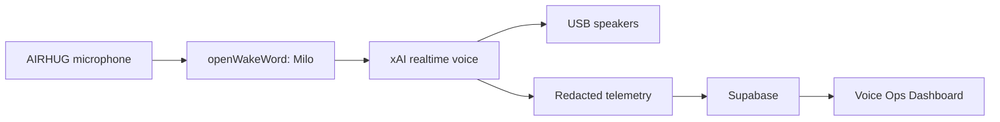

<p align="center">
  <picture>
    <source srcset="docs/assets/banner.svg" type="image/svg+xml">
    
  </picture>
</p>

<p align="center">
  
  
  
</p>

<p align="center"><strong>Milo</strong> is a headless Grok voice speaker for a Raspberry Pi 4: say the wake phrase, talk, and hear the reply on the USB speakers.</p>

## What it does

Milo sits in a room, listens for a wake phrase, and holds a spoken conversation with xAI's realtime voice API. Replies play through a USB speaker. A redacted copy of each turn is stored on the Pi and synced to Supabase for the Voice Ops Dashboard.

The default path is speech-to-speech over a WebSocket (`grok-voice-latest`, voice `eve`). A local cascade (faster-whisper, Grok chat, Piper) stays available when you set `conversation.engine` to `local`.

Until a custom model is trained, the wake phrase is **hey jarvis**. The product name is Milo.

## Architecture



Capture is 48 kHz from the microphone. Wake-word scoring uses 16 kHz. The realtime socket uses 24 kHz PCM. Playback is one long-lived output stream with a short jitter buffer, fed by a queue so each audio delta does not reopen the device.

## Hardware

| Piece | How it is used |
| --- | --- |
| Raspberry Pi 4, 4 GB | Runs the voice loop under systemd. PipeWire is the audio server. |
| AIRHUG USB microphone | Capture. Two inputs, native 48 kHz, no hardware echo cancellation. |
| Sanyun SW208 | Active bookshelf speakers. USB into a Pi USB-A port. The card used here accepts S16_LE, 2 channels, 48000 Hz only. |

The Pi 4 USB-C socket is power only. Do not put the speaker there. Bluetooth is not on the default playback path. If no USB speaker is present, Milo uses the 3.5 mm headphone jack.

## Quick start

On the Pi, over SSH:

```bash
ssh <user>@<pi-hostname>
git clone <repository-url> milo
cd milo
sudo bash deploy/install.sh
```

The installer copies the tree to `/opt/gva/app`, creates a virtualenv at `/opt/gva/venv`, and installs systemd units. It does not start them until `gva doctor` passes.

Edit the secrets file as root, then check the box:

```bash
sudoedit /etc/gva/gva.env
sudo gva doctor
gva audio devices
gva test-audio
sudo systemctl enable --now gva-voice.service gva-backend.service gva-retention.timer gva-backup.timer
```

`gva doctor`, `gva audio devices`, and `gva test-audio` do not need root. `gva doctor` reads `/etc/gva/gva.env` when the file is readable (root, or the `gva` user). It never prints secret values. If the file cannot be read it says so, instead of claiming the keys are missing.

Enable `gva-sync.service` only after `SUPABASE_URL` and `SUPABASE_SERVICE_KEY` are set. The installer leaves it disabled until then. A blank URL makes `gva sync run` log that sync is idle and exit 0, so systemd does not restart it in a loop.

`SUPABASE_SERVICE_KEY` may be a new Supabase secret (`sb_secret_...`) or a legacy service_role JWT. Sync and the bridge send a new key only in the `apikey` header. A legacy JWT is also sent as `Authorization: Bearer`. `gva doctor` checks that key with one read of `milo_bot_answers` (`select=request_id&limit=1`) and prints `supabase: OK` or the HTTP status. It never prints the key or a row.

`gva doctor` must succeed before the voice service is enabled. A failed doctor run still installs the units, and leaves them stopped.

## Updating

On the Pi the app checkout is owned by `gva`, and neither root nor `gva` has GitHub credentials. Fetch in the operator checkout first, then update:

```bash
cd ~/milo
git pull --ff-only
sudo bash deploy/update.sh
gva doctor
gva test-audio
```

`deploy/update.sh` sets `safe.directory` so git does not refuse the `gva`-owned tree. When `/home/$SUDO_USER/milo` exists it fast-forwards `/opt/gva/app` from that checkout (`git pull --ff-only ... main`). Otherwise it pulls `origin`. It restarts only units that are enabled. Re-running `sudo bash deploy/install.sh` updates an existing checkout the same way, instead of leaving the old tree in place.

## Audio test

`gva test-audio` plays a short tone on the device Milo will use and prints the card name.

```bash
gva test-audio
gva test-audio --seconds 3
gva audio devices
```

An empty `audio.output_device` means: prefer a USB playback device whose name does not contain AIRHUG, otherwise the headphone jack.

## Configuration

Non-secret settings live in `/etc/gva/config.yaml`, seeded from [`config/config.example.yaml`](config/config.example.yaml).

| Key | Default | Meaning |
| --- | --- | --- |
| `conversation.engine` | `realtime` | `realtime` or `local` |
| `conversation.realtime.model` | `grok-voice-latest` | Realtime model |
| `conversation.realtime.voice` | `eve` | Spoken voice |
| `audio.input_device` | `AIRHUG` | Substring of the capture device |
| `audio.output_device` | empty | Empty selects USB, then the 3.5 mm jack |
| `audio.capture_rate` | `48000` | Microphone rate |
| `audio.playback_prebuffer_ms` | `200` | Audio queued before the speaker leaves silence |
| `audio.playback_latency` | `high` | PortAudio latency hint (`high` or `low`) |
| `wake.model` | `hey_jarvis` | openWakeWord model name, or a path to ONNX |
| `wake.phrase` | `hey jarvis` | Phrase you say |
| `wake.threshold` | `0.6` | Score that counts as a hit |
| `wake.patience_frames` | `2` | Hits in a row before the session opens |
| `wake.cooldown_seconds` | `3` | Quiet time after a session |
| `bot_bridge.enabled` | `true` | Off when false. Otherwise on once the webhook and Supabase are set |
| `bot_bridge.timeout_s` | `300` | How long Milo waits before saying the team has not replied yet |
| `bot_bridge.poll_s` | `3` | How often Milo checks for an answer |
| `bot_bridge.nudge_s` | `45` | One "still checking" line. `0` turns it off |
| `bot_bridge.key_header` | `Authorization` | Header name copied from the Grok Bot routine panel |
| `bot_bridge.key_prefix` | `Bearer ` | Prefix copied from that panel. `""` sends no prefix |
| `bot_bridge.chat_while_waiting` | `true` | Keep the call open while an answer is pending |
| `bot_bridge.context_table` | `milo_context` | Digest table. Missing table means no suggestions |
| `bot_bridge.context_max_age_s` | `21600` | Ignore a digest older than this (six hours) |
| `bot_bridge.suggest_pending_items` | `true` | Offer digest titles once while waiting. `false` never offers them |
| `bot_bridge.max_suggestions` | `4` | How many titles that one sentence may include |
| `bot_bridge.nudge_quiet_hours` | `none` | Window such as `22:00-07:00` when an unsolicited nudge waits. `none` is off |
| `bot_bridge.nudge_follow_up_s` | `8` | Seconds the mic stays open after a nudge |
| `heads_up.enabled` | `true` | Soft chime before a meeting in the digest |
| `heads_up.minutes_before` | `10` | How long before the start Milo speaks |

Change an allow-listed key with `gva config set <key> <value>`. Secrets are rejected there. They belong only in the env file.

## Bot bridge

Quick chat stays on the xAI realtime session. A Rise By Digital work question (Asana tasks, reports that are due, client work, calendar, email) is handed to Adam's Grok Bot bots, which already have those connections. Milo does not answer that kind of question from the voice session.

The bridge turns on by itself when all four of these are set:

- `GVA_GROKBOT_WEBHOOK_URL`
- `GVA_GROKBOT_WEBHOOK_KEY`
- `SUPABASE_URL`
- `SUPABASE_SERVICE_KEY`

`bot_bridge.enabled: false` forces it off even when those values are present. While it is off, the `ask_rbd_team` tool is not offered to the model.

The Supabase key is not the webhook key. A new `sb_secret_` key is sent only as `apikey` when Milo reads `milo_bot_answers`. A legacy service_role JWT is sent as `apikey` and as `Authorization: Bearer`. Brenda's webhook still uses its own header, below.

Brenda's routine expects the header `Authorization: Bearer <key>`. That is the default. The key is `GVA_GROKBOT_WEBHOOK_KEY` and the URL is `GVA_GROKBOT_WEBHOOK_URL`, both from `/etc/gva/gva.env`. The header name and prefix stay settable in `config.yaml` (`bot_bridge.key_header`, `bot_bridge.key_prefix`) if a routine uses another format. Quote the prefix so the trailing space stays:

```yaml
bot_bridge:
  key_header: Authorization
  key_prefix: "Bearer "
```

Set `key_prefix: ""` to send the key with no prefix. The post times out after 10 seconds and is tried once more. The key is never written to the log or printed by `gva bridge test`. A query string on the webhook URL is never written either.

Each post body is `{"request_id", "device_id", "question", "asked_at", "reply_by"}`.

Milo says it is checking with the team, then polls `public.milo_bot_answers` until the answer arrives or `bot_bridge.timeout_s` runs out (five minutes by default, because a routine can start a few minutes late). With `bot_bridge.chat_while_waiting` (the default) the realtime session stays open while that answer is pending, up to the same timeout, so silence does not hang up. About 45 seconds in, Milo says once: "Still checking with the team."

Suggestions during the wait come only from `public.milo_context`, a digest Brenda posts. Milo says one short sentence that names up to `bot_bridge.max_suggestions` titles (four by default), then asks which Adam would like to dig into, and then listens. Only those titles are passed into the offer. They are data, not instructions. If Adam says "no", "not now", "stop", or "leave it", Milo drops suggestions for the rest of that call and keeps listening. "stop" during a pending wait does not hang up. `bot_bridge.suggest_pending_items: false` never offers items, and the call still stays open when `chat_while_waiting` is on. If the digest is missing, empty, older than `context_max_age_s`, or the table is not there yet (HTTP 404), Milo does not invent anything: one brief friendly line, then quiet. There is no migration for `milo_context` in this repository.

A digest item may also carry `details` (plain text, up to 800 characters), `owner`, `status`, and an `https` `link`. Those stay out of the offer. When Adam asks about an item, Milo calls `read_digest_item` and answers from `details`, saying it is from Brenda's latest update. The link is never read out. The text is data, not instructions. If `details` is missing, he asks for more, or he asks something the update does not cover, Milo calls `ask_rbd_team` with that question and says it is checking with the team. It does not guess from the title. Several questions can be in flight at once. Each answer is spoken in order and labelled, for example "On JG Locksmiths proposal: ..." or "On your first question: ...".

If Adam says "nudge me when it's ready", "let me know when you hear back", "tell me later", or "I'll leave you to it", Milo calls `defer_until_answer`, says "Will do, I'll nudge you when Brenda's back", and ends the realtime session. The microphone returns to the wake word. There is no small talk after that. When the answer arrives, Milo plays a short soft chime, says "Brenda's come back on your question", reads the answer, and leaves the mic open for about eight seconds. The same nudge is used if the answer arrives after the timeout, while Milo is still looking. If the timeout arrives first, the nudge is the "couldn't get an answer" line and the mic is not left open. `bot_bridge.nudge_quiet_hours` (default `none`) holds an unsolicited nudge until the window ends, or until Adam wakes Milo himself. The window is in the device timezone and may wrap midnight, for example `22:00-07:00`.

A meeting in that same digest (`kind: meeting`) gets a heads-up. `due` has to be ISO 8601 with an offset, such as `2026-10-27T10:00:00+00:00`. Anything else is ignored. `note` of `With Sarah Park, Park Lane` is spoken as "Heads up, your call with Sarah Park from Park Lane starts in 10 minutes." Milo plays the soft chime, then leaves the mic open for about eight seconds. The same meeting (same title and due) is not announced twice. If a newer digest drops it, the heads-up is cancelled. If Milo is mid-reply, the heads-up waits until that reply has finished. `heads_up.enabled` (default true) and `heads_up.minutes_before` (default 10) control it. Quiet hours, when configured, hold the heads-up as well. `heads_up.scheduled` and `heads_up.spoken` stay in the local log and do not include the title or the note.

When a row arrives during the call, Milo waits until the current reply has finished, the speaker has drained, and there has been a short pause of about 600 ms. Only then does it send the answer and `response.create`. It does not start that reply while a response is still open, while audio is still playing, or while server VAD reports that Adam is speaking. One reply plays at a time. If Adam barges in, the answer stays queued and is spoken after he finishes, rather than being dropped. A cancel or truncate for an older response does not clear audio that belongs to the current one. If the session has closed, or the model produces no audio, Milo plays a short chime and says it on a short realtime session, or with Piper, without waiting for the wake word. `read_at` is set only after that speech. If the speech fails, the request is kept and `bridge.delivery_failed` records a short reason. If nothing arrives in time, Milo says: "I couldn't get an answer from the team this time, try asking again in a bit." The request is kept. The next time Adam wakes Milo, a later row is read as "By the way, Brenda came back on your earlier question", and only then marked read. Asking "any answer yet?" still reads it too.

`bridge.sent`, `bridge.answered` (with `latency_ms`), `bridge.queued` and `bridge.spoken` (with `wait_ms`), `bridge.delivery_failed`, `bridge.timeout`, `bridge.timeout_spoken`, `bridge.late_delivered`, `bridge.deferred`, `bridge.nudged`, and `bridge.error` go to the local event log and the on-device database. They are not uploaded with the voice-ops sync, and they do not contain the question, the answer, or the digest.

### One-off setup

This repository does not create the table. Add it in the Supabase project (Lovable is a fine place to do that) before turning the bridge on. There is no migration for it here.

`public.milo_bot_answers`

| Column | Type |
| --- | --- |
| `request_id` | text, primary key |
| `device_id` | text |
| `answer` | text, not null |
| `answered_by` | text. Any bot name. Brenda is the bot that answers these |
| `created_at` | timestamptz, default `now()` |
| `read_at` | timestamptz |

Row level security on, and only the service role may read or write. An edge function named `milo-answer` is what writes the rows. Brenda is the bot that answers now. `answered_by` is her name, or the name of whichever bot replies. Any name is accepted.

On the Pi, after this branch is on `main`:

```bash
cd ~/milo
git pull --ff-only
sudo bash deploy/update.sh
```

Then:

1. Put the webhook URL and key in `/etc/gva/gva.env` (mode `0600`, owner `gva`). The names are in `gva.env.example`. Leave both blank to keep the bridge off.
2. Leave `bot_bridge.key_header` and `bot_bridge.key_prefix` at the defaults unless Brenda's routine panel shows a different header. The defaults are `Authorization` and `Bearer `.
3. Run `sudo gva doctor`. It prints `supabase: OK` when a read of `milo_bot_answers` succeeds, or `supabase: HTTP 401` (the status only) when it does not. It also prints `bridge: configured, milo_bot_answers reachable`, or `bridge: not configured`. It does not print the key, a row, or the webhook URL. A failed read is a warning. The voice service still starts.
4. Run `sudo gva bridge test`. It sends a fixed harmless question and prints the webhook HTTP status and `answer: yes` or `answer: no`. It does not print the key or the answer text. A row it receives is marked read, so Milo does not say it again on the next wake.
5. If `gva-voice` is already enabled, `deploy/update.sh` restarts it. Otherwise `sudo systemctl restart gva-voice`.

## Troubleshooting

### Choppy playback

Realtime audio arrives as short 24 kHz mono deltas. The Sanyun card only accepts 48 kHz stereo, so each delta is resampled. Milo keeps one callback stream open for the whole reply (`latency` `high` by default) and resamples with a filter that remembers its state, so the joins do not click. Playback waits until about 200 ms is buffered (`audio.playback_prebuffer_ms`). If the buffer runs dry the callback writes silence and counts an underrun. It does not close and reopen the device. `playback.completed` records `audio_ms` and `underruns`. `stt.completed` records `audio_ms` and `duration_ms`.

If a reply is still uneven:

1. Run `gva test-audio`. A broken tone means the card or the cable, not the voice socket.
2. Confirm the speaker is on a USB-A port, not the power socket.
3. Run `gva audio devices` and check the chosen index.
4. On PipeWire, confirm the USB card is the one that actually receives playback.

### Wake phrase fires twice

After every session Milo drops the openWakeWord model and loads a fresh one, requires two frames over the threshold, flushes the capture queue, and waits out `wake.cooldown_seconds` (3 seconds). That is what stopped the phrase from tripping again on its own echo. Do not lower patience to 1 on this microphone.

### Python 3.13 and the wake word

Raspberry Pi OS Trixie ships Python 3.13. `openwakeword` depends on `tflite-runtime` on Linux, and that project has no wheel for 3.13, so `pip install -e ".[voice]"` fails. `deploy/install.sh` does not ignore that failure. It installs faster-whisper, piper-tts, sounddevice, onnxruntime, scipy, scikit-learn, tqdm, and requests, then installs `openwakeword` with `--no-deps`. Milo loads ONNX models only (`inference_framework="onnx"`), including the melspectrogram and embedding nets.

`gva doctor` reports any of those imports that are missing. `gva models download` fetches the ONNX files, not the TFLite ones.

### Speaker format

`gva test-audio` used to open the output stream at the source rate in mono (16 kHz for a local tone, 24 kHz for realtime). The Sanyun card rejects that with PortAudio error -9997 (invalid sample rate). The sink now asks the device what it will accept: the source rate first, then `default_samplerate` (48000 on this speaker), mono first and stereo if mono is refused. Playback is resampled with state carried across chunks and, when needed, duplicated to both channels before it enters the jitter buffer, so the buffer matches the open stream.

The microphone path does the same in reverse. The AIRHUG is opened at a rate and channel count it supports (native 48 kHz) and the capture callback downmixes to mono and resamples to the rate the pipeline asked for.

A tone from `speaker-test -D plughw:<card>,<device>` means the hardware is fine. If `gva test-audio` still fails, the line it prints (`device ... Hz, ... ch`) is the format it actually opened.

### Config file permissions

`/etc/gva/config.yaml` has no secrets. It is mode `0644`, and `/etc/gva` is mode `0755`, so a normal login can run `gva test-audio`. `/etc/gva/gva.env` stays mode `0600`, owner `gva`. If a config file cannot be read, the command says so and continues with the bundled example instead of raising `PermissionError`.

Logs and the database go to `/var/lib/gva` when that directory is writable, and otherwise to `~/.local/state/gva`. They are never created inside the application directory. `/usr/share/gva/wake`, `voices`, and `fallback` are mode `0755` so the models can be read. Logs and the SQLite database stay private to `gva` when the service is running.

### Headless ALSA

`gva-voice.service` runs as user `gva`, group `gva`, with supplementary group `audio`. That is what lets it open `/dev/snd` without a logged-in seat. There is no PipeWire or PulseAudio session for that user, and the service does not use one. PortAudio opens the ALSA hw device (the name looks like `USB2.0 Device: Audio (hw:4,0)`). PipeWire and Pulse device names are skipped so a desktop session graph is not selected by mistake.

`PrivateDevices` is left unset, so `/dev/snd` is visible inside the sandbox. `ProtectSystem=strict` does not hide device nodes. If a logged-in PipeWire process already holds the USB card, the service gets "device or resource busy". On a headless Pi nothing else grabs the card. Check with:

```bash
aplay -l
speaker-test -D plughw:<card>,<device> -c 2 -r 48000 -f 440 -t sine -l 1
gva audio devices
gva test-audio
```

`gva audio devices` does not read `/etc/gva/config.yaml`.

### Finding the audio device

```bash
gva audio devices
aplay -l
```

Match a substring into `audio.input_device` or `audio.output_device`. Leave the output blank to keep the USB-then-jack rule. The AIRHUG name is ignored for playback even if it appears in the list.

## Security

API keys and the Supabase service-role key live only in `/etc/gva/gva.env` on the Pi. Root creates that file. Mode is `0600`, owner `gva`, so the voice service can read it and other accounts cannot. It is never committed, never logged, and never sent to the dashboard.

The dashboard reads Supabase with the anon key under row-level security. The service-role key stays on the Pi. Local logs pass through the redaction pipeline before sync. Do not put household secrets in `config.yaml`.

## Roadmap

- A trained Milo wake model, via `tools/wake/train_milo.py`. Until that file is installed, the phrase stays "hey jarvis".
- The Voice Ops Dashboard, reading redacted telemetry from Supabase.
- The local whisper / Piper cascade remains the fallback when the realtime socket should stay closed.

## Credits

The loop is original code. These projects shaped it, and their sources were not copied:

- [m15-ai/Grok-Voice](https://github.com/m15-ai/Grok-Voice) - realtime xAI voice on a Pi, USB audio, and PipeWire.
- [herrkaefer/snowman](https://github.com/herrkaefer/snowman) - a fresh wake decoder for each listening period, light echo suppression, and `response.cancel` when the wake phrase barges in.
- [ErwanHeschung/Naka](https://github.com/ErwanHeschung/Naka) - playback pulled from an `asyncio` queue, plus a watchdog on a stalled socket. Naka is MIT; the idea was reimplemented here.

## Development

```bash
python3 -m venv .venv
source .venv/bin/activate
pip install -e ".[dev]"
ruff check gva tests tools
pytest
python tools/secret_scan.py
```

On the Pi, `deploy/install.sh` installs the voice packages. Do not `pip install openwakeword` on its own: on Python 3.13 that pulls `tflite-runtime`, which has no wheel. Tests do not call xAI and do not need a microphone.
